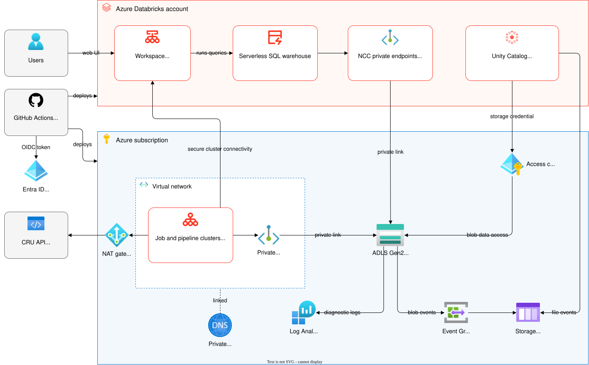
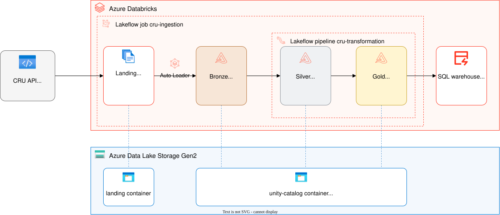
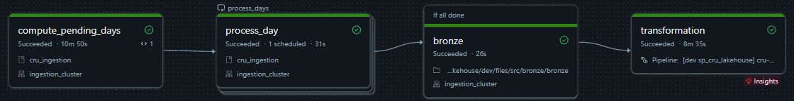
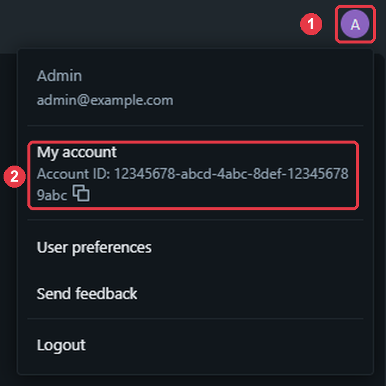

# cru-lakehouse

Azure Databricks lakehouse ingesting Poland's Central Register of Contracts (Centralny Rejestr Umów, CRU).

## Architecture



*Prod. Dev runs on the Databricks-managed VNet and keeps the storage account's public endpoint, see [Networking](#networking).*

### Data flow



Ingestion, Bronze, Silver, and Gold all run in one Databricks workspace per environment (`dev`, `prod`), deployed as a single Declarative Automation Bundle. Terraform provisions the Azure resources underneath (resource group, storage, networking, the workspace) and the catalog, schemas, and landing volume in Unity Catalog.

### Ingestion

The `cru-ingestion` job runs every night at 03:00 Polish time in prod. In dev, development mode pauses the schedule, so runs are started by hand. It keeps a ledger: a table with one row for every attempt to download a day's data, saying whether the attempt succeeded or failed, and why. The job uses it to know which days still need downloading.

Each run:

1. **Finds the days to download:** every day since 1 July 2026, when the register started, that has no successful attempt in the ledger yet. On a normal night that is only the previous day. After an outage, it also includes every day that was missed.
2. **Downloads each of those days**, two days at a time. For one day, it:
   1. asks the CRU API for all agreements changed that day. The API returns at most 10,000 results per query, so on a busier day it asks about one voivodeship at a time.
   2. asks a second time and combines both answers, so an agreement is very unlikely to be missed because the list changed while it was being read.
   3. downloads every agreement's full record and saves it unchanged, as a JSON file, in the landing zone.
   4. writes the result, success or failure, to the ledger.
3. **Updates the tables:** Bronze loads the new files, which Auto Loader finds through storage file events, then Silver and Gold are refreshed.



*A dev backfill of one day.*

Requests to the API are spaced out and retried after temporary errors, waiting as long as the API asks, up to 30 seconds. To process only a specific period, run the job with `backfill` set to `1` and `date_from` / `date_to` set to the first and last day, as `YYYY-MM-DD`. A backfill processes only the days in that range that the ledger hasn't recorded as successful. A successful day doesn't need fetching again, because editing an agreement updates its modification date, and the nightly run fetches it under that new date.

### Networking

Prod storage is reachable only over private networking and by trusted Azure services. The workspace is VNet-injected with secure cluster connectivity, so cluster nodes have no public IPs and reach the internet through a NAT gateway. The storage account has public network access disabled, and classic compute reaches it through private endpoints resolved by private DNS zones. The serverless SQL warehouse connects through a network connectivity configuration (NCC).

Dev runs on the Databricks-managed VNet, and its storage account keeps its public endpoint. Access is still Entra ID only, with shared keys disabled. See [Dev without network isolation](#dev-without-network-isolation) for why.

## Prerequisites

- **Tools:** Terraform 1.15 or later, the Azure CLI, and the GitHub CLI.
- **Permissions to run `infra/bootstrap`:**
  - Azure subscription: Contributor and Role Based Access Control Administrator, or Owner, to create the state backend and the subscription-scope role assignments.
  - Entra ID tenant: a role that can create app registrations and security groups (e.g. Application Developer and Groups Administrator).
- **An organizational Entra ID user with the Global Administrator role, for the first sign-in to the Databricks account console.** That first sign-in makes the user the account's first account admin. Personal Microsoft accounts can't sign in to the account console, even as Global Administrator, so if the subscription was created with one, create a member user in the tenant for this.
- **Azure resource provider registrations.** Register these resource providers on the subscription:

  ```bash
  az provider register --namespace Microsoft.Storage
  az provider register --namespace Microsoft.Network
  az provider register --namespace Microsoft.Compute
  az provider register --namespace Microsoft.ManagedIdentity
  az provider register --namespace Microsoft.Databricks
  az provider register --namespace Microsoft.EventGrid
  az provider register --namespace Microsoft.Insights
  az provider register --namespace Microsoft.OperationalInsights
  ```

## Deployment steps

### 1. Bootstrap (once, by hand)

`infra/bootstrap` runs first, by hand with your own Azure login, because it creates the identities and the remote state backend that CI uses for every other root module:

- The deploy service principal (`sp-cru-lakehouse`) and its subscription-scope role assignments
- A second service principal (`sp-cru-databricks-admin`) for the Databricks account-level resources, which you make an account admin below
- GitHub OIDC federated credentials on each of these two service principals, one per GitHub Actions context that authenticates to Azure:
  - `gh-environment-dev`: jobs that use the `dev` environment
  - `gh-environment-prod`: jobs that use the `prod` environment
  - `gh-pull-request`: pull request checks and plans
  - `gh-ref-main`: jobs on `main` without an environment, such as the prod plans
- The service principals that Databricks jobs run as (`sp-cru-dev-dbw-job` / `sp-cru-prod-dbw-job`)
- The `az-cru-dev` / `az-cru-prod` / `az-cru-lakehouse-admins` Entra ID groups
- The Terraform remote state backend (resource group, storage account, and container)

```bash
cd infra/bootstrap
cp terraform.tfvars.example terraform.tfvars   # fill in subscription_id, tenant_id and github_sub_claim_prefix
gh api repos/<owner>/<repo>/actions/oidc/customization/sub --jq .sub_claim_prefix   # github_sub_claim_prefix
terraform init
terraform apply
```

Set the GitHub Actions repository variables from the bootstrap output:

1. Export the variables to `github.env` using one of the following commands, depending on your shell:

   Bash (requires `jq`):

   ```bash
   terraform output -json github_variables | jq -r 'to_entries[] | "\(.key)=\(.value)"' > github.env
   ```

   PowerShell:

   ```powershell
   (terraform output -json github_variables | ConvertFrom-Json).PSObject.Properties | ForEach-Object { "$($_.Name)=$($_.Value)" } | Set-Content github.env
   ```

2. Upload them and delete the file:

   ```bash
   gh variable set -R <owner>/<repo> -f github.env
   rm github.env
   ```

Set the remaining values by hand:

| Name | Type | Value |
|---|---|---|
| `DATABRICKS_ACCOUNT_ID` | variable | the account ID from the Databricks account console, see below |
| `ALERT_EMAIL` | secret | the address notified when the ingestion job fails or runs longer than an hour |

To find the account ID, sign in to the account console ([https://accounts.azuredatabricks.net](https://accounts.azuredatabricks.net)), click your avatar in the top right (1), and copy the ID under My account (2):



Create two GitHub environments, `dev` and `prod`. Add required reviewers to `prod`.

Grant `sp-cru-databricks-admin` the account admin role: in the account console ([https://accounts.azuredatabricks.net](https://accounts.azuredatabricks.net)), go to User management > Service principals, add it as a Microsoft Entra ID managed service principal with its application ID (`DATABRICKS_ADMIN_CLIENT_ID`), then turn on Account admin on its Roles tab.

The account console opens only once the tenant has an Azure Databricks workspace. In a tenant without one, set `DATABRICKS_ACCOUNT_ID` and the account admin role after step 2 creates the dev workspace, then run `terraform-apply-dev.yml` again from the Actions tab, since its `apply infra/envs/account` job fails without them.

### 2. Dev infrastructure

Run `terraform-apply-dev.yml` from the Actions tab. It also runs on pushes to `main` that change `infra/envs/dev/`, `infra/envs/account/`, or `infra/modules/`. It applies three root modules in order, in the `dev` environment:

1. `infra/envs/dev/01-azure`:
   - Resource group
   - ADLS Gen2 storage account with `landing` and `unity-catalog` containers
   - Log Analytics workspace receiving the storage account's logs
   - Databricks access connector and workspace
   - Storage Blob Data Reader on the `landing` container and Reader on the storage account for the dev group
2. `infra/envs/account`:
   - Account-level groups and job service principals
   - Service Principal User role for the deploy identity on the job service principals
   - Workspace assignments
3. `infra/envs/dev/02-databricks`:
   - Unity Catalog catalog, storage credential, and external locations
   - `landing` / `bronze` / `silver` / `gold` schemas and the landing volume
   - Cluster policy and SQL warehouse
   - Workspace entitlements for the job service principal and the dev group
   - Grants and permissions on these objects

### 3. Dev bundle

After the step 2 run succeeds, run `databricks-deploy-dev.yml` from the Actions tab. It runs `databricks bundle deploy -t dev`, which deploys the `cru-ingestion` job and the `cru-transformation` pipeline. It also runs on pushes to `main` that change `databricks.yml`, `resources/`, `src/`, `pyproject.toml`, or `uv.lock`.
### 4. Prod (gated, manual trigger)

Run `terraform-apply-prod.yml`. It applies three root modules in order, and before each one it writes the plan to the run summary and waits for a `prod` reviewer to approve it:

1. `infra/envs/prod/01-azure`
2. `infra/envs/account`, which adds the prod workspace assignments
3. `infra/envs/prod/02-databricks`, which also creates the prod NCC and approves its private endpoints

Then run `databricks-deploy-prod.yml`, which also waits for a `prod` reviewer and deploys the bundle. Both run only from `main`.

## Pull request checks

Each check runs on pull requests to `main` that change the files it covers.

- `terraform-checks.yml` checks formatting and runs `terraform validate` on every root module, TFLint, `terraform test` on the `storage_account` and `service_principal` modules, and a Trivy scan that fails on misconfigurations not accepted in `.trivyignore.yaml`. It also plans dev, prod, and the account root module and posts each plan as a pull request comment, updated on every push.
- `python-checks.yml` runs ruff and the unit tests.
- `databricks-checks.yml` validates the bundle for the `dev` and `prod` targets, skipping `prod` until its infrastructure is applied.

## Design decisions

### Dev without network isolation

Dev skips prod's private networking to save cost. A storage firewall would need VNet injection and private endpoints, a cost that isn't worth paying for dev in my case, so the dev storage account keeps its public endpoint. This trade-off depends on the Databricks-managed VNet, which Microsoft [plans to deprecate](https://learn.microsoft.com/azure/databricks/security/network/classic/#deploy-a-workspace-in-your-own-virtual-network) for new classic workspaces. A future from-scratch deployment of dev will then need its own VNet, still without private endpoints.

### Repository structure

Keeping the platform in one repository lets each layer be read next to the layers it depends on, from the Azure infrastructure to the Databricks pipelines. In production I would split it by layer. `infra/envs/account` is applied by both the dev and the prod pipeline, and the dev pipeline has no approval gates. So the prod NCC, an account-level resource, is managed in `infra/envs/prod/02-databricks`, where it changes only through the prod approval gates.

### Failed days don't block the downstream layers

A day that fails stays without a successful attempt in the [ledger](#ingestion), so the next run downloads it again, while the other days carry on. The `bronze` task runs with `run_if: ALL_DONE`, so Bronze, Silver, and Gold still load whatever was downloaded when some days failed. The job run ends as Succeeded with failures, since its last task succeeded, and the failed task sends the alert email.

## Known issues

### Bot protection on the CRU API

As of November 2026, the CRU API is behind Imperva bot protection. In tests, a client sending one request every 2 seconds or faster was blocked after about 20 requests, and for up to several minutes every request got a 200 response with an HTML page saying "Request unsuccessful" instead of JSON. The job sends up to 5 requests a second for each day, so each attempt at a day is blocked after about 15 agreements and recorded as failed. The day's retries continue with the agreements still missing, but that can't keep up with a register that averages over 10,000 changed agreements a day. At one request every 3 seconds, which wasn't blocked in a 100-request test, the roughly 1.5 million agreements registered by November 2026 would take almost two months to download.

### More than 10,000 changes in one voivodeship on one day

The CRU search API returns at most 10,000 results per query. A day with more changes than that is split into one query per voivodeship of the contracting institution, and this project doesn't split any further. If a single voivodeship has more than 10,000 changes on one day, only its first 10,000 are fetched, a warning is logged, and the day is marked successful.

### Agreements edited during a search

The CRU API returns search results page by page, by position, and can't continue from the last result it returned. If an agreement is edited while a day's results are being read, it leaves that day's list and the agreements after it move up one place, so one of them can be skipped. Each day is therefore searched twice and the results combined, which makes a missed agreement very unlikely but not impossible.

### Versions replaced before the nightly run

The CRU API returns each agreement as it is at the moment of the request, not its earlier versions. If an agreement is changed and then changed again before the nightly run fetches it, the version in between is never seen, so the history in Silver goes straight from the earlier version to the later one.

### Buyers and vendors are inferred

The CRU API doesn't say which party of an agreement buys and which sells, and doesn't document the order of the parties, so this project infers the roles. The first listed party, the public body that registered the agreement, is a buyer. Other public bodies are buyers when the agreement also lists a party that isn't a public body, otherwise they are vendors. If a cession moves the vendor's side of an agreement to a public body, that body is counted as a buyer, because the record looks the same as a cession on the buyer's side. Only the free-text comment of the change tells them apart.
